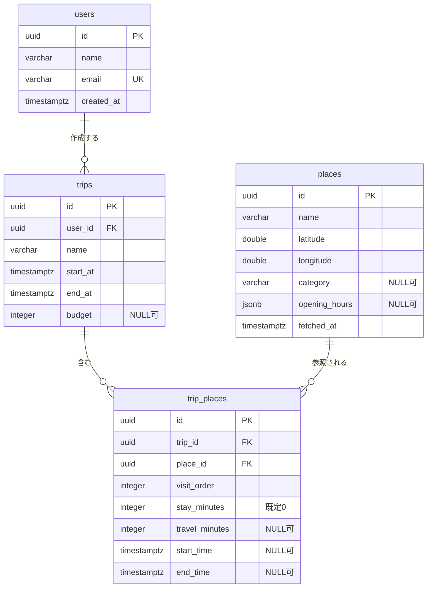

# データベース設計

## ER図

## 型の対応

PostgreSQLの型をそのまま使う。

| 表記 | PostgreSQLの型 | 備考 |
|---|---|---|
| UUID | `uuid` | 生成はアプリ側(`uuid4`)で行う |
| JSON | `jsonb` | 検索・部分更新ができる |
| TIMESTAMP | `timestamptz` | UTCで保存し、表示時にJSTへ変換 |

Migrationツールは Alembic を使う。

## NULLを許可する列

以下のみ。それ以外はNOT NULLとする。

| 列 | 理由 |
|---|---|
| trips.budget | 予算を決めずに作り始められる |
| trip_places.start_time / end_time | update_scheduleが計算するまで空 |
| trip_places.travel_minutes | 1件目は前の地点が無いため空 |
| places.opening_hours | 手入力なので不明な場合がある |
| places.category | 同上 |

trip_places.stay_minutesはNOT NULL(既定0)。空だと移動時間の計算ができないため。

## 外部キー削除時の動作

| 操作 | 動作 | 理由 |
|---|---|---|
| trips削除 | CASCADE | 旅行を消せば旅程も不要 |
| places削除 | RESTRICT | 使用中の場所を消すと旅程が壊れる |
| users削除 | RESTRICT | 旅行を持つユーザーを消すと旅行が孤児になる |

## テーブルごとの設計理由

### users

emailにUNIQUE制約を付ける。認証を入れたときにログインIDになるため。

created_atはusersにだけ持つ。他のテーブルは必要になったら追加する。

### places

placesは人間が育てるマスタではなく、選択された場所のスナップショット置き場とする。緯度経度・営業時間といった客観的事実だけを持ち、全ユーザーで共有する。

Phase 1では外部APIが無いため手入力。Phase 2以降はsearch_placesの結果から自動で入る。外部APIを導入する際にsource / external_id列を追加し、重複登録の防止と更新に使う(今は追加しない)。

営業時間や所在地は現実側が変わるため、placesは更新されうる。ただし過去の旅程が組まれた時点の営業時間までは保存しない(Phase 1では過剰)。代わりにfetched_atを持ち、「営業時間(2026-09-17時点)」のように鮮度を表示してユーザーが判断できるようにする。fetched_atはopening_hoursを更新したときだけ新しくする。

閉店した場所もレコードは削除しない。trip_placesが参照しており、削除すると過去の旅程が壊れるため。閉店を表現する必要が出たらフラグ列を追加する。

移動時間の計算はプラン変更のたびに走るため、緯度経度は手元に保持する必要がある。また旅行プランは「そのとき何を選んだか」の記録なので、外部APIから場所が消えても記録が壊れないようにする。

### trip_places

主キーはidとする。trip_id + place_idの複合キーにすると、同じ旅行で同じ場所を2回訪問できない(出発と帰りに同じ駅を通る等)。

旅程の削除・並び替えはplace_idではなくtrip_placesのidで指定する。同じ場所が旅程に2回あると、place_idではどちらか区別できないため。

visit_orderは常に1から始まる連番とする。追加は末尾(最大値+1)に入れ、途中への挿入は並び替えで行う。削除時は後ろを詰める。

stay_minutesはplacesではなくここに持つ。滞在時間は場所の客観的属性ではなく「その旅行で何分いるつもりか」という主観的な予定であり、旅行ごと・ユーザーごとに異なるため。

start_time / end_time は日時で持つ。日をまたぐ旅行にそのまま対応できる。値はupdate_scheduleが計算して埋める。

## Phase 3で作るテーブル

以下2テーブルはまだ作らない。

理由: Phase 3の入力項目にある「割り勘方法」「端数処理」を入れる列が下の定義に無く、均等割り以外を表現できない。expense_participantsにも負担額・比率の列が要る。現状の定義のまま作るとPhase 3で必ずALTER TABLEすることになるため、要件が固まってから設計し直す。

### expenses

| カラム | 型 | 説明 |
|---|---|---|
| id | UUID | 支出ID |
| trip_id | UUID | 旅行ID |
| payer_id | UUID | 支払った人 |
| amount | INTEGER | 金額 |
| description | VARCHAR | 内容 |

### expense_participants

| カラム | 型 | 説明 |
|---|---|---|
| expense_id | UUID | 支出ID |
| user_id | UUID | 負担者 |
